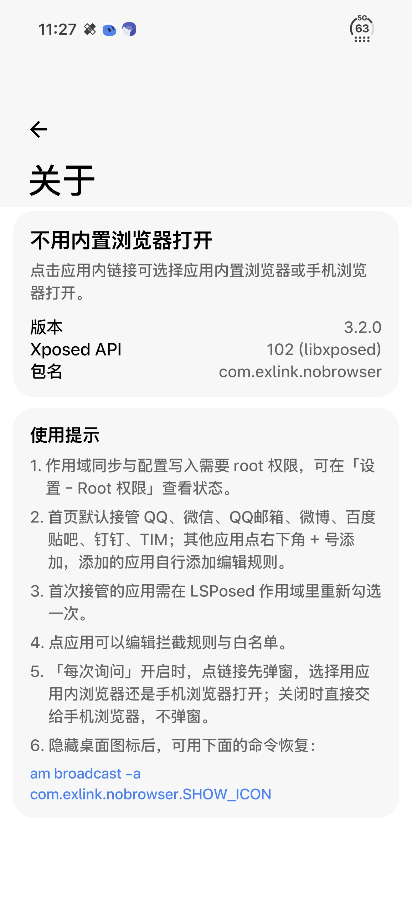
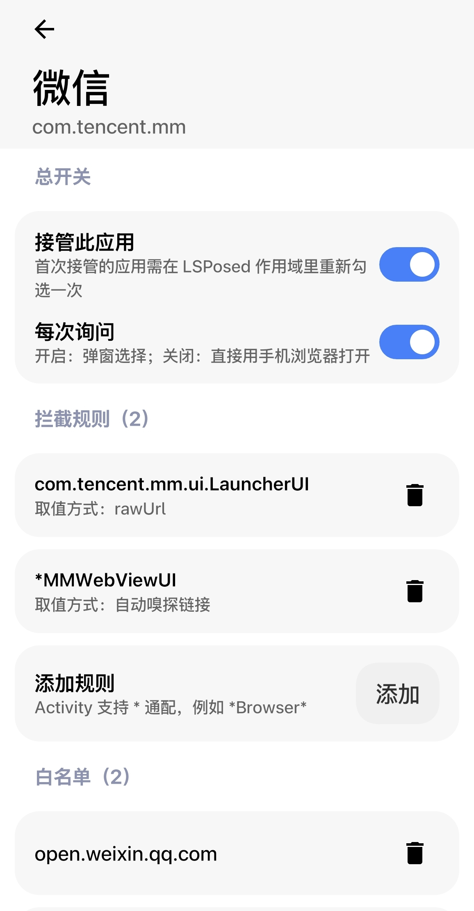

<div align="center">

# 不用内置浏览器打开

**ExLink · NoBrowser** — 把应用内置浏览器里的链接抢出来，交给你自己的浏览器

[](https://github.com/SoL01St/exlindev/releases)
[](https://developer.android.com)
[](https://github.com/libxposed/api)
[](LICENSE)

在微信、QQ、TIM、QQ邮箱、钉钉、百度贴吧里点开链接时，不再被塞进又慢又难用的应用内置浏览器。

</div>

<p align="center">
  
  
</p>


**默认接管：QQ、微信、QQ邮箱、百度贴吧、钉钉、TIM。其他应用点右下角 `+` 添加，需用户自行添加规则。**

已知问题:微信钱包内点账单会跳弹窗选择，关了弹窗的会自动跳转外部浏览器会话过期。解决方法:在微信规则添加白名单 wechatpay.cn 域名放行。以后版本更新再内置这条规则


## 概况

基于[xloger/ExLink](https://github.com/xloger/ExLink)修改。项目从代码到文档，全部由 AI 生成。开发者负责提出需求、验证效果与把控方向，实现一律交给 AI。
| | |
| --- | --- |
| 包名 | `io.github.sol01st.nobrowser` |
| 版本 | 5.0.1（versionCode 33） |
| 运行环境 | LSPosed · libxposed API 102 |
| 系统 | Android 8.0+（minSdk 26 / targetSdk 36），测试于 HyperOS 4 · Android 17 |
| 界面 | Jetpack Compose + [Miuix](https://github.com/compose-miuix-ui/miuix) |

## 特性

**拦截**

- **可选弹窗**：开启「每次询问」时点链接弹出选择框，可选用应用内浏览器还是手机浏览器；关闭后直接交给手机浏览器
- **实时生效**：改完开关不用杀应用，下一次点链接就按新配置走（拦截前检查配置文件时间戳）
- **规则引擎**：Activity 支持 `*` `?` 通配、不区分大小写，按目标 Activity 匹配（无显式目标时退回按发起方）
- **单条开关**：每条规则、每条白名单都能单独启停，关掉的条目立即不参与匹配
- **取值方式**：`ExAuto`（自动嗅探 data/extras/Bundle 里的 http 链接）、`ExDat`（只读 Intent.data）或指定 extras key；取不到时自动回退为全文嗅探
- **白名单**：按域名放行，命中的链接保持在应用内打开
- **作用域双向同步**：在 LSPosed 里勾选/取消作用域，模块首页自动同步；在模块里开关应用也会写回 LSPosed

**界面**

- 卡片化列表、贴底通栏底栏、横滑页面切换，进出二级页列表位置零位移
- 提示条为真毛玻璃（Android 12+ 真实模糊，低版本自动回退）
- 主题模式：跟随系统 / 浅色 / 深色，点选即时生效

**工具**

- **备份与恢复**：立即备份、按时间点自选恢复、长按删除单份，自动只保留最近 5 份
- **规则导入 / 导出**：JSON 格式（含格式版本号），可从文件恢复
- **运行状态**：设置页顶部直显 Root 权限与 LSPosed 模块状态，异常标红点
- **诊断**：一键导出诊断报告（版本 / 机型 / 系统 / 作用域 / 规则统计 / 最近注入日志）
- **检查更新**：关于页读取 GitHub 最新 Release 并与当前版本比较
- **下拉刷新**：重新扫描已安装应用，新装应用无需重启模块
- **长按移除**：从首页移除应用时保留其规则，重新添加自动恢复
- **按模板重置**：编辑页可把某个应用的规则与白名单一键恢复成内置模板
- **扫一扫友好**：微信等应用的扫一扫结果留在应用内打开，不会被误拦

内置规则里的每一条、每个白名单域名都可以单独关掉——比如不需要拦截某个页面，把对应规则关掉即可，不用整条删除。

## 安装

1. 从 [Releases](https://github.com/SoL01St/exlindev/releases) 下载 APK 安装
2. 在 LSPosed 中启用模块，勾选需要接管的应用
3. 打开一次模块并授予 root 权限（写入作用域与配置文件需要）
4. **首次接管某个应用后，需要在 LSPosed 作用域里对它重新勾选一次**（LSPosed 对后写入的作用域不会即时注入）

## 使用

- 首页开关：开启即接管并写入 LSPosed 作用域，关闭则移除
- 点应用进入规则页：编辑拦截规则、白名单、每次询问
- 下拉首页：重新扫描应用列表并同步作用域
- 长按应用：从首页移除（规则保留，重新添加自动恢复）
- 设置页：运行状态 / 外观（主题模式）/ 规则（导出、导入、备份、恢复）/ 诊断 / 关于

## 构建

需要 JDK 17、Android SDK Platform 37 与 Build-Tools 36.0.0、Gradle 8.14.x + AGP 8.13.x。

```bash
# 1. 生成签名
keytool -genkeypair -keystore keystore/release.jks -alias release \
  -keyalg RSA -keysize 2048 -validity 10000 \
  -storepass 你的密码 -keypass 你的密码 \
  -dname "CN=ExLink.NoBrowser, O=Dev, C=CN"

# 2. 签名信息写进 ~/.gradle/gradle.properties（不要提交）
cat >> ~/.gradle/gradle.properties <<'EOF'
RELEASE_STORE_FILE=/绝对路径/keystore/release.jks
RELEASE_STORE_PASSWORD=你的密码
RELEASE_KEY_ALIAS=release
RELEASE_KEY_PASSWORD=你的密码
EOF

# 3. 构建
./gradlew assembleRelease
```

签名信息全部通过 gradle 属性读取，仓库内不含任何密钥或密码；读不到时自动回退 debug 签名，clone 下来即可直接编译。

> 在 ARM 设备上本地构建（qemu 跑 aapt2）需在 `gradle.properties` 加 `android.aapt2FromMavenOverride=/path/to/aapt2`，x86_64 电脑不需要。

## 目录结构

```
app/src/main/java/io/github/sol01st/nobrowser/
├── core/    数据模型、内置规则、URL 处理
├── data/    规则存储、LSPosed 作用域、主题偏好、诊断、更新检查
├── hook/    libxposed 入口与拦截逻辑（注入宿主进程，不使用 Compose）
└── ui/      Compose + Miuix 界面
app/src/main/resources/META-INF/xposed/
├── java_init.list   入口类
├── module.prop      模块元信息
└── scope.list       推荐作用域
```

## 已知限制

- **微博**：LSPosed 无法把模块注入微博进程（作用域勾选、重启都试过，日志里没有任何注入记录），规则保留但不在默认列表
- **首次接管的应用**需要在 LSPosed 里重新勾选一次作用域，这是 LSPosed 的缓存机制，模块无法绕过
- 在 LSPosed 模块列表里开关本模块后返回，列表会按启用状态重排并定位到本模块，这是 LSPosed 自身行为
- 作用域写入与配置发布依赖 root（通过内置 sqlite3 直接维护 LSPosed 数据库与 `/data/local/tmp/nxb_config.json`）

## 第三方组件

`app/src/main/assets/nxbin/` 下的二进制来自 [Termux](https://github.com/termux/termux-packages) 的 ARM64 构建，用于在设备上维护 LSPosed 数据库：

| 文件 | 组件 | 许可证 |
| --- | --- | --- |
| `sqlite3` | SQLite 3 | Public Domain |
| `libz.so.1` | zlib | zlib License |
| `libreadline.so.8` | GNU Readline | GPL v3 |
| `libncursesw.so.6` | ncurses | MIT-like |
| `libtinfo.so.6` | ncurses (terminfo) | MIT-like |
| `libandroid-support.so` | libandroid-support | Apache 2.0 |

其中 GNU Readline 为 GPL v3，重新分发包含它的 APK 时请一并遵守其条款。

## 致谢

- [xloger/ExLink](https://github.com/xloger/ExLink)：原始规则与思路
- [libxposed/api](https://github.com/libxposed/api)：现代 Xposed API
- [compose-miuix-ui/miuix](https://github.com/compose-miuix-ui/miuix)：Miuix Compose 组件
- [chrisbanes/haze](https://github.com/chrisbanes/haze)：提示条的背景模糊效果

## License

MIT
