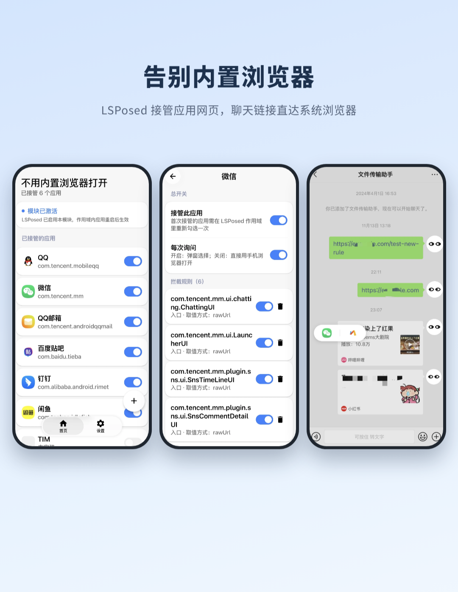

# 不用内置浏览器打开

**ExLink · NoBrowser** — 把应用内置浏览器里的链接抢出来，交给你自己的浏览器

在微信、QQ、TIM、QQ邮箱、钉钉、百度贴吧、闲鱼里点开链接时，不再被塞进又慢又难用的应用内置浏览器。

  

**默认接管：QQ、微信、QQ邮箱、百度贴吧、钉钉、TIM、闲鱼。其他应用点右下角 `+` 添加，需自行添加规则。**

## 概况

基于 [xloger/ExLink](https://github.com/xloger/ExLink) 修改。

| | |
| --- | --- |
| 包名 | `io.github.sol01st.nobrowser` |
| 运行环境 | LSPosed · libxposed API 102 |
| 系统 | Android 13+（minSdk 33 / targetSdk 34） |
| 界面 | [Compose Multiplatform](https://github.com/JetBrains/compose-multiplatform) + [Miuix](https://github.com/compose-miuix-ui/miuix) 0.9.5 |

## 特性

- **入口白名单**：只拦截已登记的发起方点出的链接，扫码、钱包、服务页等默认放行
- **可选弹窗**：开启「每次询问」时弹窗选择应用内 / 手机浏览器，关闭后直接交给手机浏览器
- **外链中转解包**：闲鱼、QQ 邮箱、钉钉自动还原真实地址
- **规则引擎**：Activity 支持 `*` `?` 通配；每条规则、白名单可单独启停
- **实时生效**：改完开关不用杀应用，下一次点链接就按新配置走
- **白名单**：按域名放行，支持 `=host` 精确匹配
- **免 root**：作用域与配置走 LSPosed 接口，不授权 root 也能用（模块日志需 root）
- **隐藏桌面图标**：关掉桌面图标后，仍可从 LSPosed 模块设置右下角「打开」进入
- **备份与恢复**：按时间点自选恢复，自动保留最近 5 份
- **导入 / 导出**：JSON 格式，可从文件恢复

## 安装

1. 从 [Releases](https://github.com/SoL01St/exlindev/releases) 下载 APK 安装
2. 在 LSPosed 中启用本模块，勾选所需应用作用域，重启目标应用

## 致谢

- 拦截规则与整体思路：[xloger/ExLink](https://github.com/xloger/ExLink)
- 模块框架：[libxposed/api](https://github.com/libxposed/api)
- 界面组件：[compose-miuix-ui/miuix](https://github.com/compose-miuix-ui/miuix)

## License

MIT
